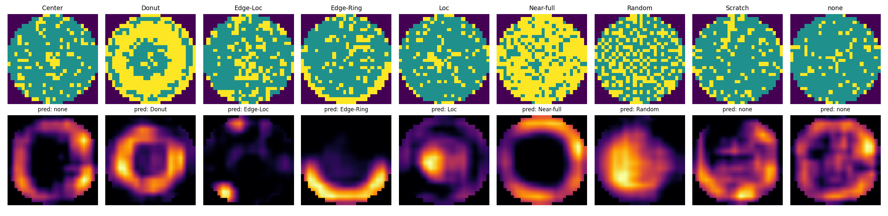
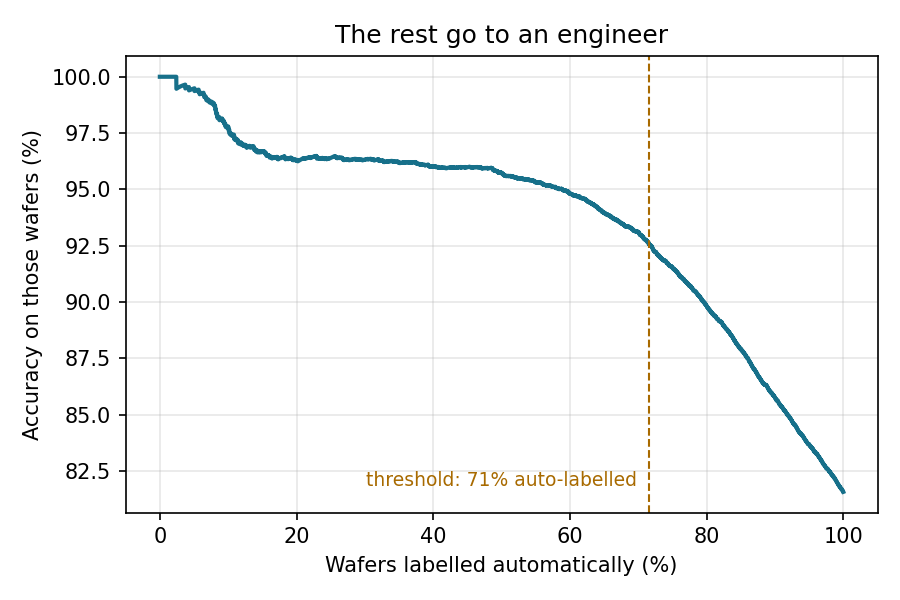
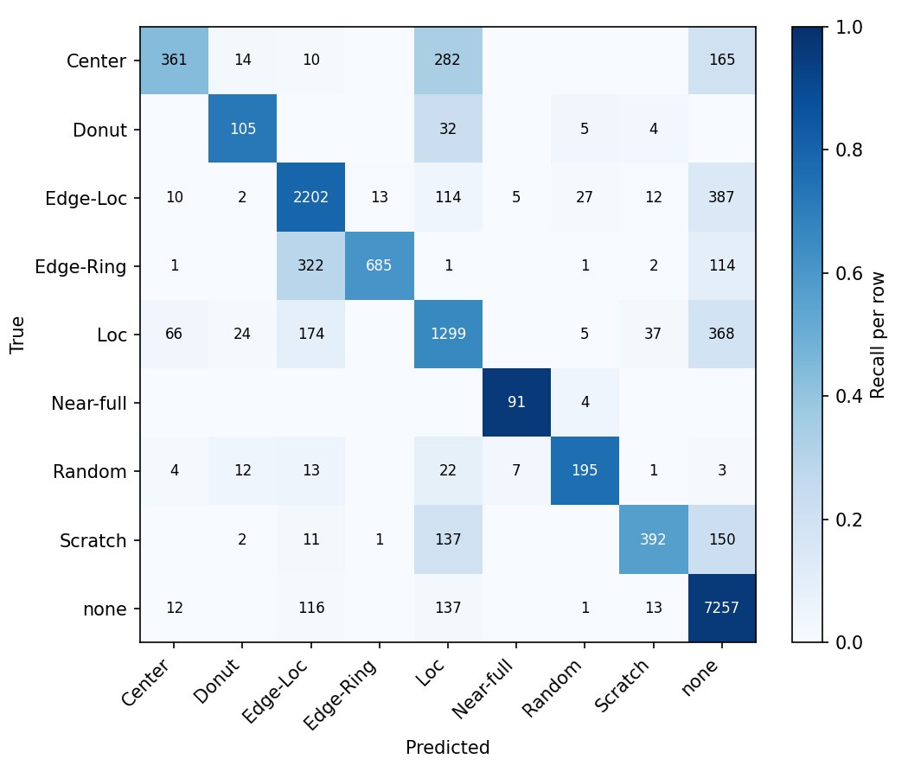
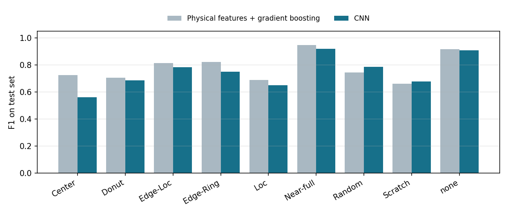

# Wafer map defect classification

[](https://github.com/rubinolorenzo/wafer-defect-classifier/actions/workflows/tests.yml)
**[▶ Live demo](https://huggingface.co/spaces/rubinolorenzo/wafer-defect-classifier)**

Automatic recognition of failure patterns on semiconductor wafer maps (public **WM-811K** dataset), built the way a fab would actually use it:

1. **Classify** 9 defect patterns with a compact CNN.
2. **Explain** each prediction with Grad-CAM.
3. **Know when to ask a human:** calibrated confidence, and uncertain wafers routed to an engineer.
4. **Point to the process:** each pattern is linked to likely root causes and to what to check first.
5. **Triage whole lots**, including the ~80 % of wafers that have no label.

> **Why.** In a fab, the spatial pattern of failing dies tells a yield engineer which process step to investigate. An edge ring points to edge effects in deposition or etch, while a scratch points to CMP or handling. Classifying thousands of wafers by hand is slow. A classifier that is silently wrong is worse, so this project puts as much weight on *when not to trust the model* as on accuracy.



## Highlights

| | |
|---|---|
| **Physics-aware design** | Two input channels (inside wafer / failing die), nearest-neighbour resizing so no fractional dies are invented, and only rotation and flip augmentation, because radial position carries meaning |
| **Interpretable baseline + hybrid** | Rotation-invariant physical features (radial profile, edge-sector asymmetry, shape of the largest failure cluster) fed to gradient boosting, then combined with the CNN: the two make different mistakes |
| **Test-time augmentation** | Predictions averaged over the 8 orientations of the map, so the model is exactly rotation-invariant, like the defect classes |
| **Calibration and reject option** | Temperature scaling, plus a confidence threshold tuned on validation to reach a target accuracy (99 % by default). Wafers below it are flagged for review |
| **Lot triage report** | Runs on unlabeled lots, stacks failure maps across wafers (systematic problems add up, random ones average out) and lists hypotheses and wafers to review ([example](docs/example_triage/report.md)) |
| **Root-cause guide** | [docs/root_causes.md](docs/root_causes.md): from pattern to process hypothesis |
| **Model card** | [MODEL_CARD.md](MODEL_CARD.md), generated by every training run: intended use, limits, results |
| **Engineering hygiene** | Unit tests, GitHub Actions CI with an end-to-end smoke run, and a reproducible CLI |

## Results

Test-set macro-F1 on WM-811K with the dataset's **original Training/Test split** (15,430 test wafers; the `none` class capped at 10,000 wafers before splitting). One run, 20 epochs, Kaggle T4 GPU.

| Data | CNN | CNN + TTA | Physical baseline | Hybrid | Calibration error (ECE) before → after | Auto-labelled (99 % target) | Accuracy on auto-labelled |
|---|---|---|---|---|---|---|---|
| **WM-811K** | 0.734 | 0.748 | 0.782 | **0.805** | 0.025 → 0.067 | 71 % | 92.6 % |
| Synthetic (pipeline check) | 0.961 | 0.971 | 0.988 | 0.990 | 0.084 → 0.022 | 94 % | 98.7 % |

### What the real data shows

* **Physics helps.** The interpretable feature model (radial profile, edge asymmetry, cluster shape) beats the CNN on its own, and combining the two beats both: they make different mistakes.
* **The official split is a distribution shift.** Validation macro-F1 (drawn from the Training part) reached 0.945, while the Test part gives 0.748. The two parts of WM-811K differ, much like a fab's data drifts over time. This is also why calibration fitted on validation data got *worse* on the test set, and why the 99 % target became 92.6 %: **a threshold tuned on old data must be re-checked on new data.**
* **The errors make physical sense.** The biggest confusions are between neighbouring patterns: 29 % of Edge-Ring wafers are called Edge-Loc (a partial ring looks like a local edge defect), and 34 % of Center wafers are called Loc (a small centre cluster looks like a local one). The next most common error is a weak pattern being called `none`.
* **Best and worst classes.** Near-full (F1 0.92) and `none` (0.91) are easy. Center (0.56), Loc (0.65) and Scratch (0.68) are the hardest.

<p>


</p>



## Quick start

```bash
pip install -e ".[dev]"
pytest
python -m wafermap.train --synthetic --epochs 6       # about 2 minutes on a laptop CPU
python -m wafermap.triage --synthetic --model outputs
```

## Real data

1. Download **WM-811K** (`LSWMD.pkl`, about 2 GB) from Kaggle (search for "WM-811K wafer map") into `data/`.
2. Train with the dataset's original split, so results are comparable with published work:

```bash
python -m wafermap.train --data data/LSWMD.pkl --split official --epochs 20
```

3. Triage lots, labeled or not:

```bash
python -m wafermap.triage --data data/LSWMD.pkl --model outputs --max-lots 50
```

The first run caches the cleaned 64×64 maps next to the pickle, so later runs start in seconds. Useful options are `--max-none` (cap on defect-free wafers, default 10 000), `--target-accuracy` (default 0.99) and `--no-baseline`.

## Live demo

**[Open the demo](https://huggingface.co/spaces/rubinolorenzo/wafer-defect-classifier)**: generate a pattern, draw failing dies with the mouse, or upload your own map (`.csv` / `.npy`, values 0/1/2). It shows the calibrated probabilities, the class activation map, the review flag and the process hypotheses.

The model runs **in the browser** with ONNX Runtime Web, so the demo is a free static page with no server. `web/export.py` converts the trained PyTorch model to `web/model.onnx` and adds the class activation maps to the graph: with global average pooling and one linear layer they are exact and need no gradients. A GitHub Action publishes `web/` to Hugging Face Spaces on every push.

After retraining:

```bash
python web/export.py --model models --out web   # then commit web/
```

For a local Gradio version with Grad-CAM, run `pip install -e ".[demo]"` and `python app.py`.

## Repository structure

```
src/wafermap/
  data.py         loading WM-811K (incl. the old-pandas pickle issue), cleaning, resizing, per-lot iteration
  model.py        compact CNN (~290k parameters)
  train.py        training, TTA, calibration, reject threshold, baseline + hybrid, figures, model card
  features.py     physical features + gradient boosting baseline
  uncertainty.py  temperature scaling, ECE, coverage curve, threshold selection
  explain.py      Grad-CAM
  predict.py      load a trained model and classify new maps
  triage.py       lot-level report
  rootcause.py    pattern → hypotheses (used by triage and the demo)
  synthetic.py    synthetic maps for tests and demos
app.py            Gradio demo (local)
web/              in-browser demo: index.html, model.onnx, export script
docs/             figures, root-cause guide, example triage report
tests/            unit tests (run in CI)
```

## Next steps

- [x] Train on WM-811K and fill in the results table
- [ ] Reduce the Training→Test gap: recalibrate on a slice of recent data, stronger augmentation for Center and Scratch
- [ ] Compare with a pretrained ResNet-18
- [ ] Mean ± standard deviation over several seeds
- [ ] Mixed-type patterns (MixedWM38 dataset)
- [ ] Use process sensor data (UCI SECOM) to predict failures before electrical test

## Data source

Wu, M.-J., Jang, J.-S. R., & Chen, J.-L. (2015). *Wafer Map Failure Pattern Recognition and Similarity Ranking for Large-Scale Data Sets.* IEEE Transactions on Semiconductor Manufacturing, 28(1), 1–12.

## License

MIT
