# Lot triage report

Model trained on: WM-811K · auto-label threshold 0.86 (target accuracy 99%)

| Lot | Wafers | Die yield | Dominant pattern | To review |
|---|---|---|---|---|
| lot38 | 25 | 77.4% | Near-full | 1 |
| lot25 | 25 | 79.8% | Random | 5 |
| lot34 | 25 | 80.9% | Edge-Loc | 2 |
| lot40 | 25 | 81.0% | Random | 1 |
| lot48 | 25 | 81.0% | Edge-Loc | 3 |
| lot8 | 25 | 81.1% | Edge-Loc | 1 |
| lot20 | 25 | 81.2% | Edge-Loc | 0 |
| lot24 | 25 | 81.5% | Scratch | 1 |
| lot19 | 25 | 81.5% | Edge-Loc | 1 |
| lot50 | 25 | 81.7% | Edge-Loc | 0 |
| lot16 | 25 | 81.8% | Edge-Loc | 0 |
| lot41 | 25 | 81.8% | Edge-Loc | 3 |
| lot30 | 25 | 81.8% | Loc | 2 |
| lot43 | 25 | 81.9% | Edge-Loc | 2 |
| lot28 | 25 | 82.0% | Edge-Loc | 2 |
| lot27 | 25 | 82.1% | Edge-Loc | 1 |
| lot45 | 25 | 82.2% | Edge-Loc | 0 |
| lot46 | 25 | 82.2% | Edge-Loc | 0 |
| lot13 | 25 | 82.2% | Random | 1 |
| lot39 | 25 | 82.2% | Edge-Loc | 0 |
| lot44 | 25 | 82.3% | Loc | 0 |
| lot17 | 25 | 82.4% | Edge-Loc | 1 |
| lot33 | 25 | 82.4% | Edge-Loc | 2 |
| lot42 | 25 | 82.5% | Edge-Loc | 3 |
| lot37 | 25 | 82.9% | Edge-Loc | 0 |
| lot26 | 25 | 82.9% | Loc | 3 |
| lot2 | 25 | 90.7% | Edge-Loc | 10 |
| lot5 | 25 | 91.8% | Scratch | 11 |
| lot4 | 25 | 92.2% | Scratch | 6 |
| lot3 | 25 | 93.1% | Edge-Loc | 8 |
| lot6 | 25 | 93.2% | Scratch | 12 |
| lot1 | 25 | 95.4% | Loc | 2 |
| lot35 | 25 | 80.4% | none | 2 |
| lot14 | 25 | 82.0% | none | 3 |
| lot32 | 25 | 82.2% | none | 2 |
| lot29 | 25 | 82.3% | none | 3 |
| lot11 | 25 | 82.3% | none | 2 |
| lot9 | 25 | 82.4% | none | 0 |
| lot7 | 25 | 82.5% | none | 0 |
| lot47 | 25 | 82.6% | none | 1 |
| lot36 | 25 | 82.8% | none | 1 |
| lot31 | 25 | 82.9% | none | 2 |
| lot49 | 25 | 83.0% | none | 1 |
| lot23 | 25 | 83.0% | none | 2 |
| lot15 | 25 | 83.0% | none | 0 |
| lot22 | 25 | 83.2% | none | 0 |
| lot10 | 25 | 83.3% | none | 1 |
| lot12 | 25 | 83.5% | none | 2 |
| lot21 | 25 | 83.5% | none | 1 |
| lot18 | 25 | 83.5% | none | 3 |

## Lot lot38

**25 wafers** · die yield 77.4% · dominant pattern: **Near-full**

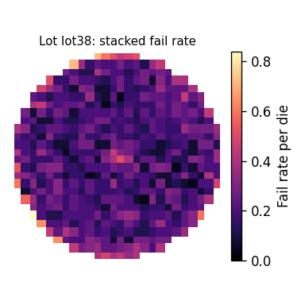

| Pattern | Wafers |
|---|---|
| Loc | 1 |
| Near-full | 1 |
| none | 22 |
| *needs review* | 1 |

**Hypotheses:** Gross failure: wrong or aborted recipe, skipped step, severe equipment fault, test set-up problem.

**Check first:** Lot history for aborts or reworks; retest on a known-good tester.

Wafers to review by hand: 1

## Lot lot25

**25 wafers** · die yield 79.8% · dominant pattern: **Random**

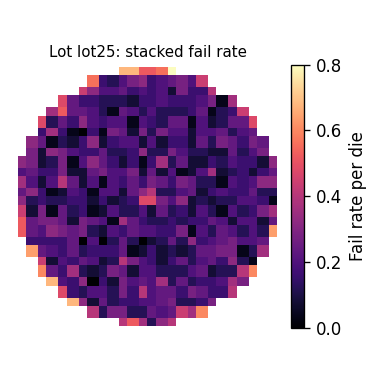

| Pattern | Wafers |
|---|---|
| Random | 1 |
| none | 19 |
| *needs review* | 5 |

**Hypotheses:** Diffuse contamination or a parametric shift affecting all dies.

**Check first:** Particle counts; parametric test data; whether the whole lot is affected.

Wafers to review by hand: 5, 15, 18, 21, 22

## Lot lot34

**25 wafers** · die yield 80.9% · dominant pattern: **Edge-Loc**

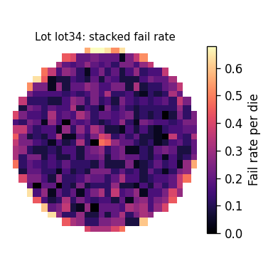

| Pattern | Wafers |
|---|---|
| Edge-Loc | 1 |
| none | 22 |
| *needs review* | 2 |

**Hypotheses:** Contact or shadowing on one side: clamps, handling contacts, notch alignment, edge chipping.

**Check first:** Position relative to the notch; robot / clamp contact points; repetition across lots.

Wafers to review by hand: 3, 7

## Lot lot40

**25 wafers** · die yield 81.0% · dominant pattern: **Random**

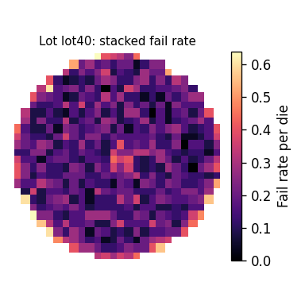

| Pattern | Wafers |
|---|---|
| Random | 1 |
| none | 23 |
| *needs review* | 1 |

**Hypotheses:** Diffuse contamination or a parametric shift affecting all dies.

**Check first:** Particle counts; parametric test data; whether the whole lot is affected.

Wafers to review by hand: 14

## Lot lot48

**25 wafers** · die yield 81.0% · dominant pattern: **Edge-Loc**

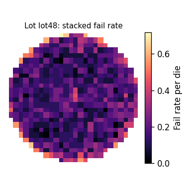

| Pattern | Wafers |
|---|---|
| Edge-Loc | 2 |
| Loc | 1 |
| Random | 1 |
| none | 18 |
| *needs review* | 3 |

**Hypotheses:** Contact or shadowing on one side: clamps, handling contacts, notch alignment, edge chipping.

**Check first:** Position relative to the notch; robot / clamp contact points; repetition across lots.

Wafers to review by hand: 2, 6, 11

## Lot lot8

**25 wafers** · die yield 81.1% · dominant pattern: **Edge-Loc**

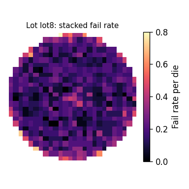

| Pattern | Wafers |
|---|---|
| Edge-Loc | 1 |
| none | 23 |
| *needs review* | 1 |

**Hypotheses:** Contact or shadowing on one side: clamps, handling contacts, notch alignment, edge chipping.

**Check first:** Position relative to the notch; robot / clamp contact points; repetition across lots.

Wafers to review by hand: 12

## Lot lot20

**25 wafers** · die yield 81.2% · dominant pattern: **Edge-Loc**

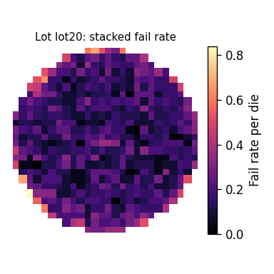

| Pattern | Wafers |
|---|---|
| Edge-Loc | 2 |
| none | 23 |

**Hypotheses:** Contact or shadowing on one side: clamps, handling contacts, notch alignment, edge chipping.

**Check first:** Position relative to the notch; robot / clamp contact points; repetition across lots.

## Lot lot24

**25 wafers** · die yield 81.5% · dominant pattern: **Scratch**

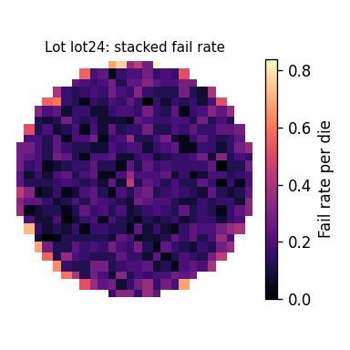

| Pattern | Wafers |
|---|---|
| Scratch | 1 |
| none | 23 |
| *needs review* | 1 |

**Hypotheses:** Mechanical damage: CMP scratches (slurry agglomerates, pad debris) or wafer handling.

**Check first:** Scratch direction; CMP consumables and slurry filtration; handling steps between inspections.

Wafers to review by hand: 1

## Lot lot19

**25 wafers** · die yield 81.5% · dominant pattern: **Edge-Loc**

| Pattern | Wafers |
|---|---|
| Edge-Loc | 1 |
| none | 23 |
| *needs review* | 1 |

**Hypotheses:** Contact or shadowing on one side: clamps, handling contacts, notch alignment, edge chipping.

**Check first:** Position relative to the notch; robot / clamp contact points; repetition across lots.

Wafers to review by hand: 7

## Lot lot50

**25 wafers** · die yield 81.7% · dominant pattern: **Edge-Loc**

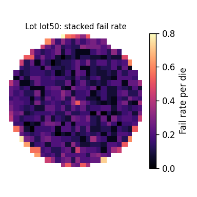

| Pattern | Wafers |
|---|---|
| Edge-Loc | 2 |
| Loc | 1 |
| none | 22 |

**Hypotheses:** Contact or shadowing on one side: clamps, handling contacts, notch alignment, edge chipping.

**Check first:** Position relative to the notch; robot / clamp contact points; repetition across lots.

## Lot lot16

**25 wafers** · die yield 81.8% · dominant pattern: **Edge-Loc**

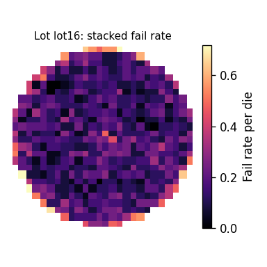

| Pattern | Wafers |
|---|---|
| Edge-Loc | 3 |
| none | 22 |

**Hypotheses:** Contact or shadowing on one side: clamps, handling contacts, notch alignment, edge chipping.

**Check first:** Position relative to the notch; robot / clamp contact points; repetition across lots.

## Lot lot41

**25 wafers** · die yield 81.8% · dominant pattern: **Edge-Loc**

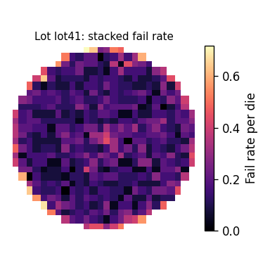

| Pattern | Wafers |
|---|---|
| Edge-Loc | 1 |
| none | 21 |
| *needs review* | 3 |

**Hypotheses:** Contact or shadowing on one side: clamps, handling contacts, notch alignment, edge chipping.

**Check first:** Position relative to the notch; robot / clamp contact points; repetition across lots.

Wafers to review by hand: 11, 15, 21

## Lot lot30

**25 wafers** · die yield 81.8% · dominant pattern: **Loc**

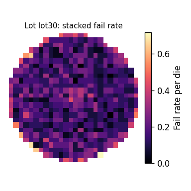

| Pattern | Wafers |
|---|---|
| Loc | 1 |
| Scratch | 1 |
| none | 21 |
| *needs review* | 2 |

**Hypotheses:** Local event: particle or contamination, local litho focus issue, local damage.

**Check first:** Defect inspection images at those coordinates; repetition on other wafers.

Wafers to review by hand: 5, 14

## Lot lot43

**25 wafers** · die yield 81.9% · dominant pattern: **Edge-Loc**

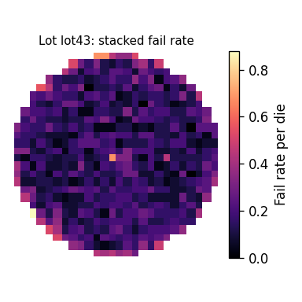

| Pattern | Wafers |
|---|---|
| Edge-Loc | 1 |
| none | 22 |
| *needs review* | 2 |

**Hypotheses:** Contact or shadowing on one side: clamps, handling contacts, notch alignment, edge chipping.

**Check first:** Position relative to the notch; robot / clamp contact points; repetition across lots.

Wafers to review by hand: 7, 25

## Lot lot28

**25 wafers** · die yield 82.0% · dominant pattern: **Edge-Loc**

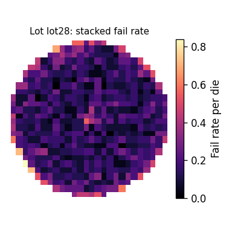

| Pattern | Wafers |
|---|---|
| Edge-Loc | 1 |
| none | 22 |
| *needs review* | 2 |

**Hypotheses:** Contact or shadowing on one side: clamps, handling contacts, notch alignment, edge chipping.

**Check first:** Position relative to the notch; robot / clamp contact points; repetition across lots.

Wafers to review by hand: 5, 6

## Lot lot27

**25 wafers** · die yield 82.1% · dominant pattern: **Edge-Loc**

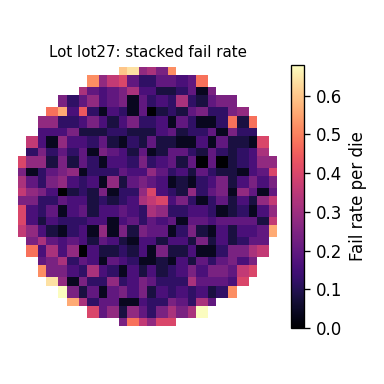

| Pattern | Wafers |
|---|---|
| Edge-Loc | 1 |
| none | 23 |
| *needs review* | 1 |

**Hypotheses:** Contact or shadowing on one side: clamps, handling contacts, notch alignment, edge chipping.

**Check first:** Position relative to the notch; robot / clamp contact points; repetition across lots.

Wafers to review by hand: 16

## Lot lot45

**25 wafers** · die yield 82.2% · dominant pattern: **Edge-Loc**

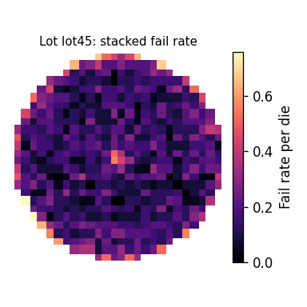

| Pattern | Wafers |
|---|---|
| Edge-Loc | 2 |
| none | 23 |

**Hypotheses:** Contact or shadowing on one side: clamps, handling contacts, notch alignment, edge chipping.

**Check first:** Position relative to the notch; robot / clamp contact points; repetition across lots.

## Lot lot46

**25 wafers** · die yield 82.2% · dominant pattern: **Edge-Loc**

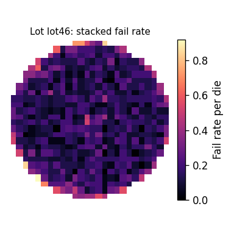

| Pattern | Wafers |
|---|---|
| Edge-Loc | 1 |
| none | 24 |

**Hypotheses:** Contact or shadowing on one side: clamps, handling contacts, notch alignment, edge chipping.

**Check first:** Position relative to the notch; robot / clamp contact points; repetition across lots.

## Lot lot13

**25 wafers** · die yield 82.2% · dominant pattern: **Random**

| Pattern | Wafers |
|---|---|
| Random | 1 |
| none | 23 |
| *needs review* | 1 |

**Hypotheses:** Diffuse contamination or a parametric shift affecting all dies.

**Check first:** Particle counts; parametric test data; whether the whole lot is affected.

Wafers to review by hand: 17

## Lot lot39

**25 wafers** · die yield 82.2% · dominant pattern: **Edge-Loc**

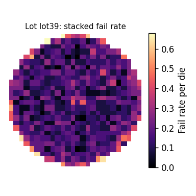

| Pattern | Wafers |
|---|---|
| Edge-Loc | 1 |
| none | 24 |

**Hypotheses:** Contact or shadowing on one side: clamps, handling contacts, notch alignment, edge chipping.

**Check first:** Position relative to the notch; robot / clamp contact points; repetition across lots.

## Lot lot44

**25 wafers** · die yield 82.3% · dominant pattern: **Loc**

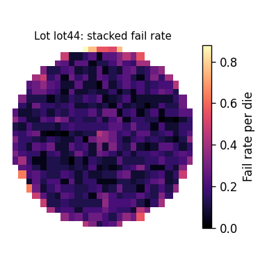

| Pattern | Wafers |
|---|---|
| Loc | 1 |
| none | 24 |

**Hypotheses:** Local event: particle or contamination, local litho focus issue, local damage.

**Check first:** Defect inspection images at those coordinates; repetition on other wafers.

## Lot lot17

**25 wafers** · die yield 82.4% · dominant pattern: **Edge-Loc**

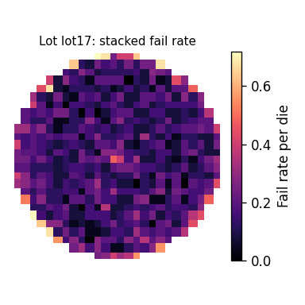

| Pattern | Wafers |
|---|---|
| Edge-Loc | 1 |
| none | 23 |
| *needs review* | 1 |

**Hypotheses:** Contact or shadowing on one side: clamps, handling contacts, notch alignment, edge chipping.

**Check first:** Position relative to the notch; robot / clamp contact points; repetition across lots.

Wafers to review by hand: 1

## Lot lot33

**25 wafers** · die yield 82.4% · dominant pattern: **Edge-Loc**

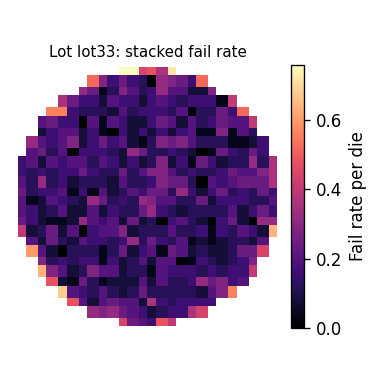

| Pattern | Wafers |
|---|---|
| Edge-Loc | 1 |
| Loc | 1 |
| none | 21 |
| *needs review* | 2 |

**Hypotheses:** Contact or shadowing on one side: clamps, handling contacts, notch alignment, edge chipping.

**Check first:** Position relative to the notch; robot / clamp contact points; repetition across lots.

Wafers to review by hand: 15, 19

## Lot lot42

**25 wafers** · die yield 82.5% · dominant pattern: **Edge-Loc**

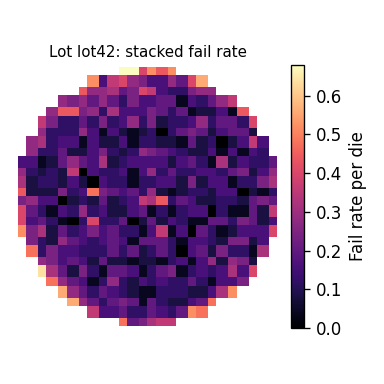

| Pattern | Wafers |
|---|---|
| Edge-Loc | 1 |
| none | 21 |
| *needs review* | 3 |

**Hypotheses:** Contact or shadowing on one side: clamps, handling contacts, notch alignment, edge chipping.

**Check first:** Position relative to the notch; robot / clamp contact points; repetition across lots.

Wafers to review by hand: 15, 21, 24

## Lot lot37

**25 wafers** · die yield 82.9% · dominant pattern: **Edge-Loc**

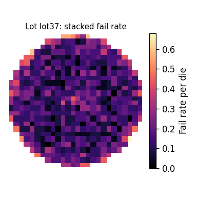

| Pattern | Wafers |
|---|---|
| Edge-Loc | 1 |
| none | 24 |

**Hypotheses:** Contact or shadowing on one side: clamps, handling contacts, notch alignment, edge chipping.

**Check first:** Position relative to the notch; robot / clamp contact points; repetition across lots.

## Lot lot26

**25 wafers** · die yield 82.9% · dominant pattern: **Loc**

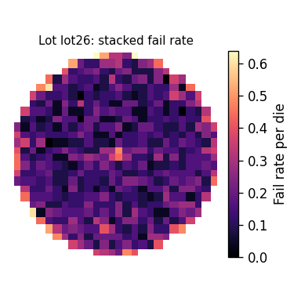

| Pattern | Wafers |
|---|---|
| Loc | 1 |
| none | 21 |
| *needs review* | 3 |

**Hypotheses:** Local event: particle or contamination, local litho focus issue, local damage.

**Check first:** Defect inspection images at those coordinates; repetition on other wafers.

Wafers to review by hand: 9, 12, 16

## Lot lot2

**25 wafers** · die yield 90.7% · dominant pattern: **Edge-Loc**

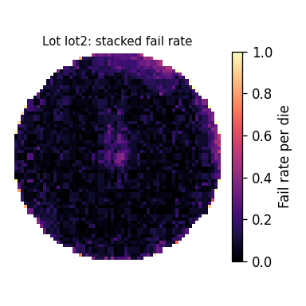

| Pattern | Wafers |
|---|---|
| Center | 1 |
| Edge-Loc | 7 |
| Loc | 1 |
| none | 6 |
| *needs review* | 10 |

**Hypotheses:** Contact or shadowing on one side: clamps, handling contacts, notch alignment, edge chipping.

**Check first:** Position relative to the notch; robot / clamp contact points; repetition across lots.

Wafers to review by hand: 2, 6, 7, 10, 11, 21, 22, 23, 24, 25

## Lot lot5

**25 wafers** · die yield 91.8% · dominant pattern: **Scratch**

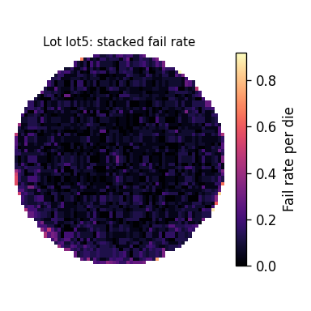

| Pattern | Wafers |
|---|---|
| Edge-Loc | 1 |
| Scratch | 2 |
| none | 11 |
| *needs review* | 11 |

**Hypotheses:** Mechanical damage: CMP scratches (slurry agglomerates, pad debris) or wafer handling.

**Check first:** Scratch direction; CMP consumables and slurry filtration; handling steps between inspections.

Wafers to review by hand: 3, 5, 6, 7, 11, 13, 16, 18, 21, 22, 25

## Lot lot4

**25 wafers** · die yield 92.2% · dominant pattern: **Scratch**

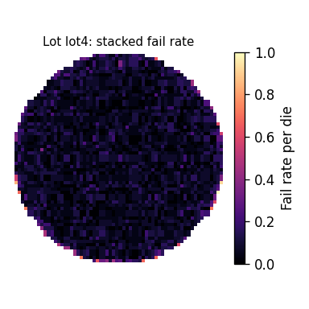

| Pattern | Wafers |
|---|---|
| Scratch | 1 |
| none | 18 |
| *needs review* | 6 |

**Hypotheses:** Mechanical damage: CMP scratches (slurry agglomerates, pad debris) or wafer handling.

**Check first:** Scratch direction; CMP consumables and slurry filtration; handling steps between inspections.

Wafers to review by hand: 3, 9, 15, 23, 24, 25

## Lot lot3

**25 wafers** · die yield 93.1% · dominant pattern: **Edge-Loc**

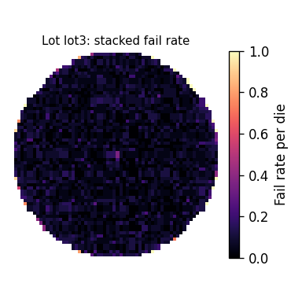

| Pattern | Wafers |
|---|---|
| Edge-Loc | 1 |
| Loc | 1 |
| none | 15 |
| *needs review* | 8 |

**Hypotheses:** Contact or shadowing on one side: clamps, handling contacts, notch alignment, edge chipping.

**Check first:** Position relative to the notch; robot / clamp contact points; repetition across lots.

Wafers to review by hand: 4, 8, 10, 11, 17, 19, 20, 23

## Lot lot6

**25 wafers** · die yield 93.2% · dominant pattern: **Scratch**

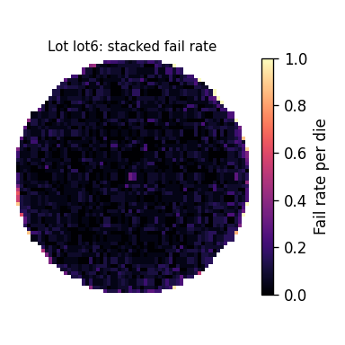

| Pattern | Wafers |
|---|---|
| Scratch | 1 |
| none | 12 |
| *needs review* | 12 |

**Hypotheses:** Mechanical damage: CMP scratches (slurry agglomerates, pad debris) or wafer handling.

**Check first:** Scratch direction; CMP consumables and slurry filtration; handling steps between inspections.

Wafers to review by hand: 3, 7, 9, 12, 14, 15, 16, 17, 18, 20, 23, 25

## Lot lot1

**25 wafers** · die yield 95.4% · dominant pattern: **Loc**

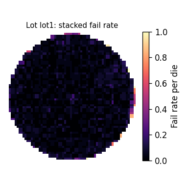

| Pattern | Wafers |
|---|---|
| Loc | 1 |
| none | 22 |
| *needs review* | 2 |

**Hypotheses:** Local event: particle or contamination, local litho focus issue, local damage.

**Check first:** Defect inspection images at those coordinates; repetition on other wafers.

Wafers to review by hand: 12, 22

## Lot lot35

**25 wafers** · die yield 80.4% · dominant pattern: **none**

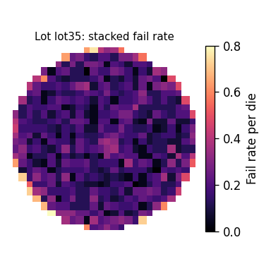

| Pattern | Wafers |
|---|---|
| none | 23 |
| *needs review* | 2 |

Wafers to review by hand: 9, 16

## Lot lot14

**25 wafers** · die yield 82.0% · dominant pattern: **none**

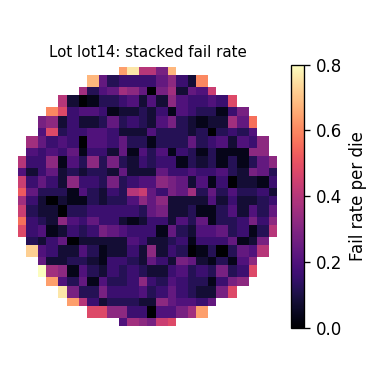

| Pattern | Wafers |
|---|---|
| none | 22 |
| *needs review* | 3 |

Wafers to review by hand: 5, 14, 19

## Lot lot32

**25 wafers** · die yield 82.2% · dominant pattern: **none**

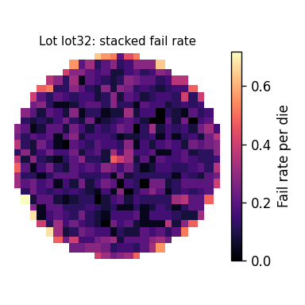

| Pattern | Wafers |
|---|---|
| none | 23 |
| *needs review* | 2 |

Wafers to review by hand: 1, 13

## Lot lot29

**25 wafers** · die yield 82.3% · dominant pattern: **none**

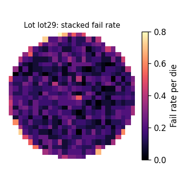

| Pattern | Wafers |
|---|---|
| none | 22 |
| *needs review* | 3 |

Wafers to review by hand: 11, 21, 22

## Lot lot11

**25 wafers** · die yield 82.3% · dominant pattern: **none**

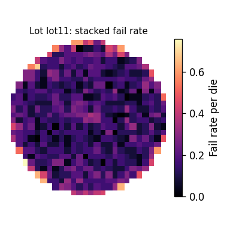

| Pattern | Wafers |
|---|---|
| none | 23 |
| *needs review* | 2 |

Wafers to review by hand: 2, 15

## Lot lot9

**25 wafers** · die yield 82.4% · dominant pattern: **none**

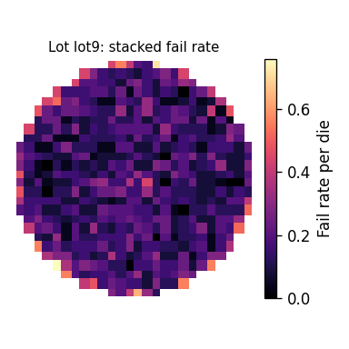

| Pattern | Wafers |
|---|---|
| none | 25 |

## Lot lot7

**25 wafers** · die yield 82.5% · dominant pattern: **none**

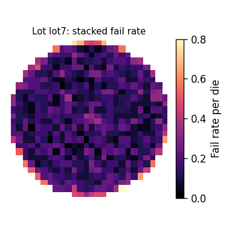

| Pattern | Wafers |
|---|---|
| none | 25 |

## Lot lot47

**25 wafers** · die yield 82.6% · dominant pattern: **none**

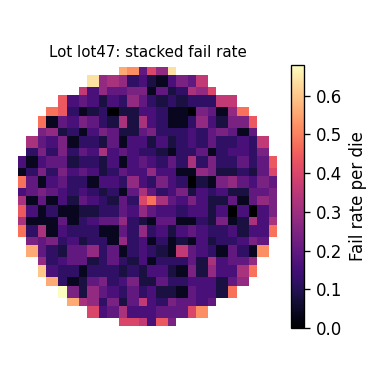

| Pattern | Wafers |
|---|---|
| none | 24 |
| *needs review* | 1 |

Wafers to review by hand: 22

## Lot lot36

**25 wafers** · die yield 82.8% · dominant pattern: **none**

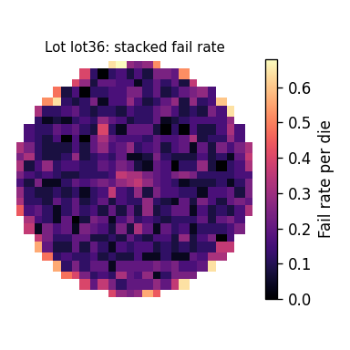

| Pattern | Wafers |
|---|---|
| none | 24 |
| *needs review* | 1 |

Wafers to review by hand: 2

## Lot lot31

**25 wafers** · die yield 82.9% · dominant pattern: **none**

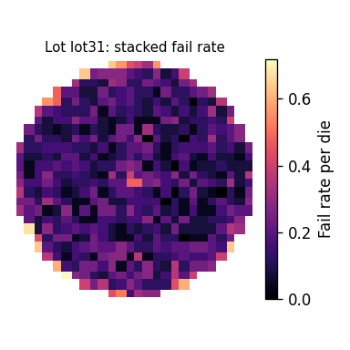

| Pattern | Wafers |
|---|---|
| none | 23 |
| *needs review* | 2 |

Wafers to review by hand: 12, 23

## Lot lot49

**25 wafers** · die yield 83.0% · dominant pattern: **none**

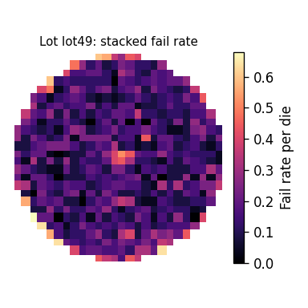

| Pattern | Wafers |
|---|---|
| none | 24 |
| *needs review* | 1 |

Wafers to review by hand: 12

## Lot lot23

**25 wafers** · die yield 83.0% · dominant pattern: **none**

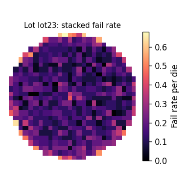

| Pattern | Wafers |
|---|---|
| none | 23 |
| *needs review* | 2 |

Wafers to review by hand: 4, 6

## Lot lot15

**25 wafers** · die yield 83.0% · dominant pattern: **none**

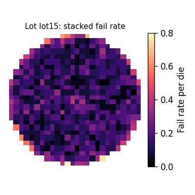

| Pattern | Wafers |
|---|---|
| none | 25 |

## Lot lot22

**25 wafers** · die yield 83.2% · dominant pattern: **none**

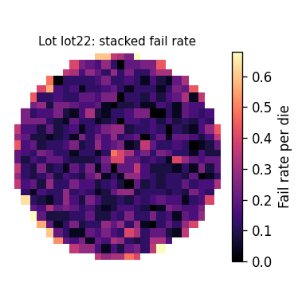

| Pattern | Wafers |
|---|---|
| none | 25 |

## Lot lot10

**25 wafers** · die yield 83.3% · dominant pattern: **none**

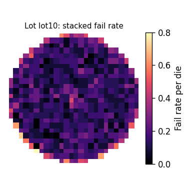

| Pattern | Wafers |
|---|---|
| none | 24 |
| *needs review* | 1 |

Wafers to review by hand: 7

## Lot lot12

**25 wafers** · die yield 83.5% · dominant pattern: **none**

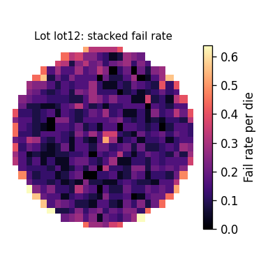

| Pattern | Wafers |
|---|---|
| none | 23 |
| *needs review* | 2 |

Wafers to review by hand: 2, 23

## Lot lot21

**25 wafers** · die yield 83.5% · dominant pattern: **none**

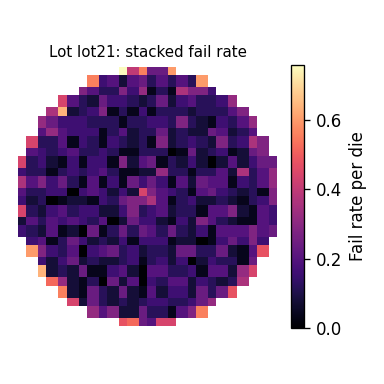

| Pattern | Wafers |
|---|---|
| none | 24 |
| *needs review* | 1 |

Wafers to review by hand: 16

## Lot lot18

**25 wafers** · die yield 83.5% · dominant pattern: **none**

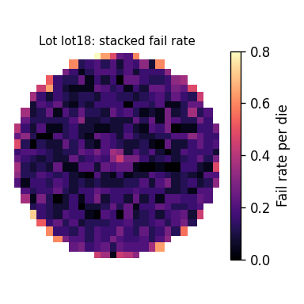

| Pattern | Wafers |
|---|---|
| none | 22 |
| *needs review* | 3 |

Wafers to review by hand: 21, 22, 25
